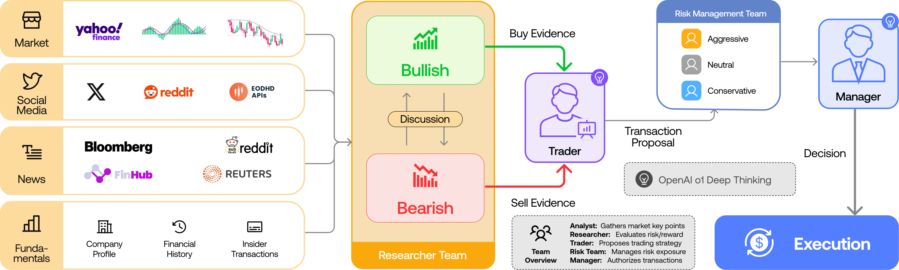
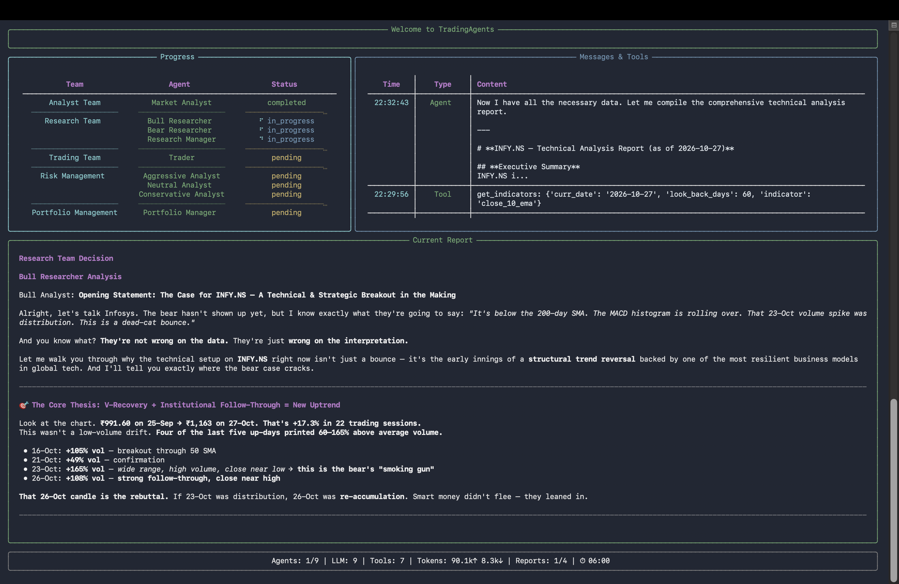
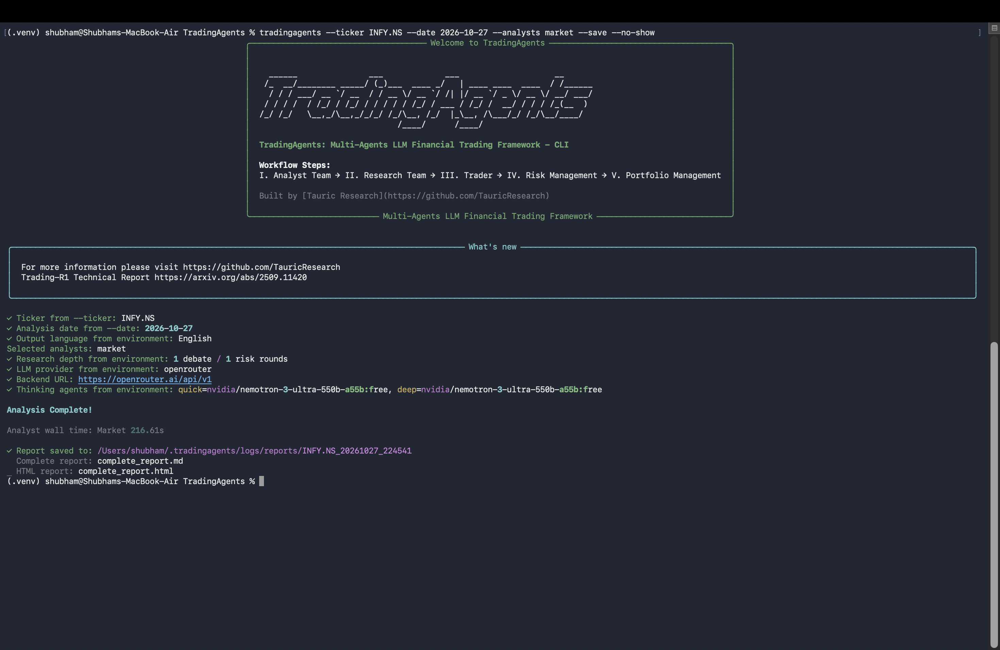

import Tabs from '@theme/Tabs';
import TabItem from '@theme/TabItem';
import useBaseUrl from '@docusaurus/useBaseUrl';

# Day 1: TradingAgents, a Multi-Agent LLM Framework for Trading Research

**Goal:** Understand how a team of AI agents can analyse a stock, and run it on Indian shares using only free models.

**Tool:** TradingAgents (by Tauric Research) with OpenRouter free models  
**Category:** AI Agents / LLMs  
**Type:** Exploration + Tutorial  
**Source code:** [TauricResearch/TradingAgents](https://github.com/TauricResearch/TradingAgents)

:::warning Not financial advice
This is a learning experiment. The output of an LLM is an opinion, not a forecast, and nothing here is a recommendation to buy or sell anything.
:::

{/* truncate */}

## 1. What I explored

TradingAgents is an open-source framework that mimics a trading firm with LLM-powered roles:

- **Analysts** look at the market (technical indicators), news, sentiment and fundamentals.
- **Bull and bear researchers** debate the case for and against the stock.
- **A trader** proposes an action, and a **risk team** and **portfolio manager** review it.

The result is a written report and a final rating, such as Buy, Hold or Underweight.

### The concept: a research desk made of agents

The cool idea is that one model does not have to jump straight from raw data to a trade. TradingAgents breaks the work into roles that resemble a research desk: analysts gather evidence, bullish and bearish researchers challenge each other's arguments, a trader turns the discussion into a proposal, and a risk team plus manager review it before a decision. That structure makes the reasoning easier to inspect and disagreements easier to spot than in a single prompt.

It is still a simulation, not a room full of independent experts: agents can share the same model weaknesses, use incomplete data, and confidently repeat unsupported claims. The workflow helps organize analysis; it does not guarantee that the conclusion is correct.



Why it caught my attention:

- It shows how agents can split a big task into specialised roles and let them argue.
- It works with any OpenAI-compatible provider, so you can run it on free models.
- It is a good case study in the strengths and weaknesses of LLM agents on a noisy, high-stakes problem.

I wanted to know: **can this work for Indian stocks, on a zero-dollar budget?**

## 2. Setup and prerequisites

- **Python:** 3.11 or later
- **Machine:** __MACHINE__ (for example, a MacBook Air, no GPU needed since the model runs remotely)
- **API key:** an [OpenRouter](https://openrouter.ai) key with a free (`:free`) model
- **Data:** Yahoo Finance tickers (`RELIANCE.NS`, `INFY.NS`), no key needed

```bash title="Terminal"
git clone https://github.com/TauricResearch/TradingAgents.git
cd TradingAgents

python3 -m venv .venv
source .venv/bin/activate
python -m pip install --upgrade pip
python -m pip install .
```

Configure the provider in `.env` (copy it from `.env.example` first):

```bash title=".env"
OPENROUTER_API_KEY=__YOUR_KEY_HERE__

TRADINGAGENTS_LLM_PROVIDER=openrouter
TRADINGAGENTS_DEEP_THINK_LLM=nvidia/nemotron-3-ultra-550b-a55b:free
TRADINGAGENTS_QUICK_THINK_LLM=__QUICK_THINK_MODEL__
TRADINGAGENTS_MAX_DEBATE_ROUNDS=1
TRADINGAGENTS_MAX_RISK_ROUNDS=1
TRADINGAGENTS_LLM_MAX_RETRIES=2
```

:::info Never commit your key
Keep `.env` out of Git, and rotate the key if you ever paste it somewhere public.
:::

## 3. Hands-on experiment

Free models change often and the agents need **tool calling**, so I queried OpenRouter for the current list instead of guessing:

```python title="list_free.py"
import requests

models = requests.get("https://openrouter.ai/api/v1/models").json()["data"]
free_tools = [
    m for m in models
    if m["id"].endswith(":free")
    and "tools" in (m.get("supported_parameters") or [])
]
for m in sorted(free_tools, key=lambda m: -(m.get("context_length") or 0)):
    print(m["id"], "| context:", m.get("context_length"))
```

Then I ran the agents from the CLI with a single analyst and one debate round to stay inside the free request limits:

```bash title="Terminal"
tradingagents --ticker RELIANCE.NS --date 2026-10-27 \
  --analysts market --save --no-show

tradingagents --ticker INFY.NS --date 2026-10-27 \
  --analysts market --save --no-show
```

The same thing from Python:

```python title="main.py"
from tradingagents.graph.trading_graph import TradingAgentsGraph
from tradingagents.default_config import DEFAULT_CONFIG

config = DEFAULT_CONFIG.copy()
config["llm_provider"] = "openrouter"
config["deep_think_llm"] = "nvidia/nemotron-3-ultra-550b-a55b:free"
config["quick_think_llm"] = "__QUICK_THINK_MODEL__"
config["max_debate_rounds"] = 1

ta = TradingAgentsGraph(debug=True, config=config)
state, decision = ta.propagate("RELIANCE.NS", "2026-10-27")
print(decision)
```

Reports are saved under a hidden folder, so I opened them from the terminal:

```bash title="Terminal"
open ~/.tradingagents/logs/reports/RELIANCE.NS_20261027_174312/complete_report.html
```

## 4. Results

<Tabs>
  <TabItem value="reliance" label="RELIANCE" default>

  The Research Manager rated RELIANCE.NS **Underweight**. The complete generated report is available as a standalone HTML file: <a href={useBaseUrl('/analysis-reports/RELIANCE_complete_report.html')}>Open the RELIANCE report</a>.

  </TabItem>
  <TabItem value="infy" label="INFY">

  The terminal screenshots below show the INFY.NS analysis. <a href={useBaseUrl('/analysis-reports/INFY_complete_report.html')}>Open the INFY report HTML</a> — this file is currently a temporary copy of the RELIANCE report and will be replaced with the generated INFY report.

  
  

  </TabItem>
  <TabItem value="run" label="Run output">

  The terminal confirms the INFY.NS analysis completed and the HTML report was saved.

  
  </TabItem>
</Tabs>

**Run details:** one run took about __RUN_TIME__ minutes and used roughly __REQUEST_COUNT__ OpenRouter requests.

:::caution Verify before you trust it
The reports contain specific numbers (debt, growth, valuation targets). They are generated by a free model and I have not independently verified them, so treat them as claims to check, not facts.
:::


## 5. Cost, privacy and limitations

- **Cost:** Free (OpenRouter `:free` models, Yahoo Finance data), within rate limits.
- **Privacy:** Prompts go to an external API. Free models may be subject to different data policies, so check your OpenRouter privacy settings and never send private data.
- **Limitations:**
  - Results can differ between runs on the same date.
  - Coverage of news and fundamentals is thinner for Indian small caps than for US stocks.
  - Yahoo Finance is an unofficial data source.
  - Free models vary in how well they handle tool calls.
  - It is research tooling, not a trading system.

## 6. Resources

- [TradingAgents on GitHub](https://github.com/TauricResearch/TradingAgents)
- [OpenRouter models](https://openrouter.ai/models)
- [Kronos, a foundation model for candlestick data](https://github.com/shiyu-coder/Kronos) (a numeric alternative I plan to compare against)
- Related article: coming soon.

:::tip Takeaway
Multi-agent LLMs are great at explaining and arguing about a stock, but treat their ratings as hypotheses to test, not signals to trade. Always verify the data, and watch your request budget.
:::
