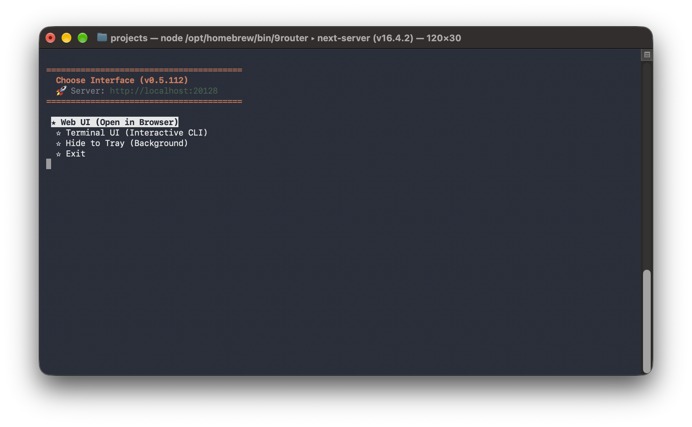
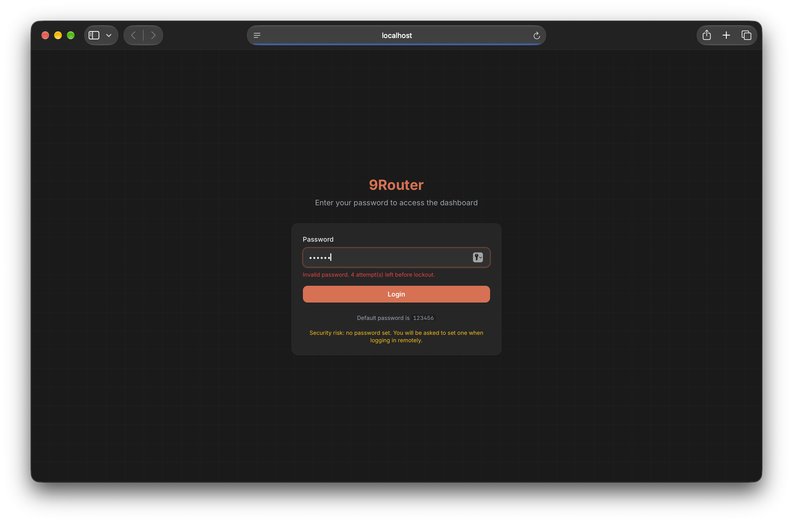
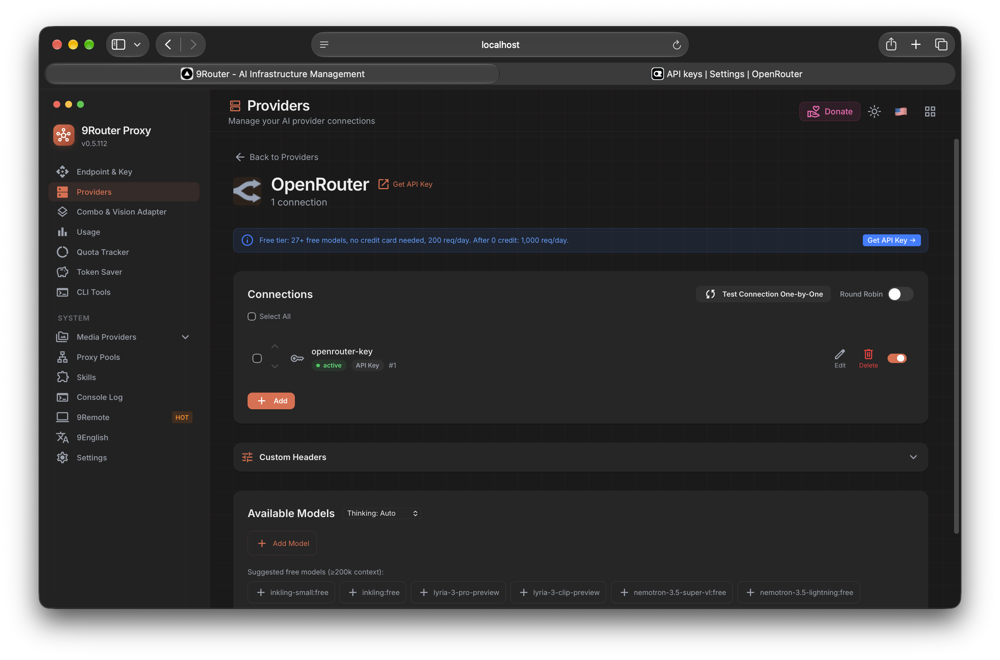
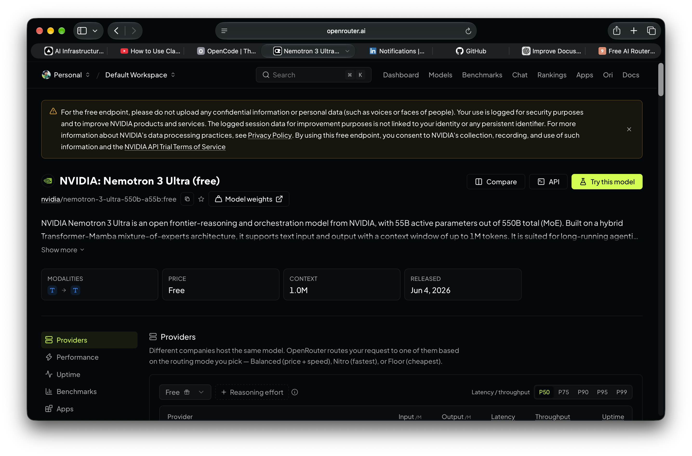
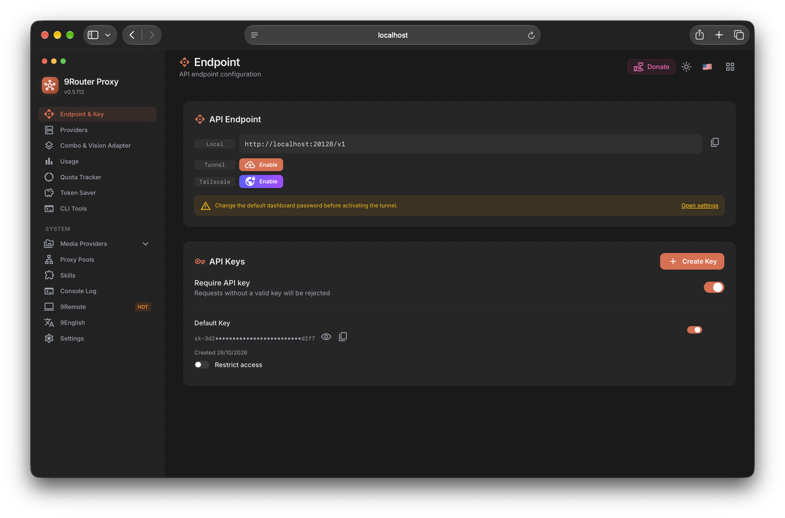
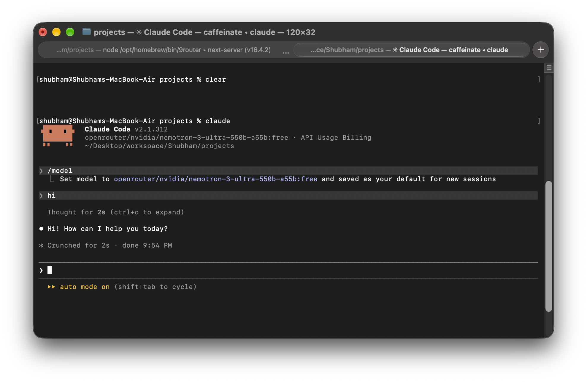
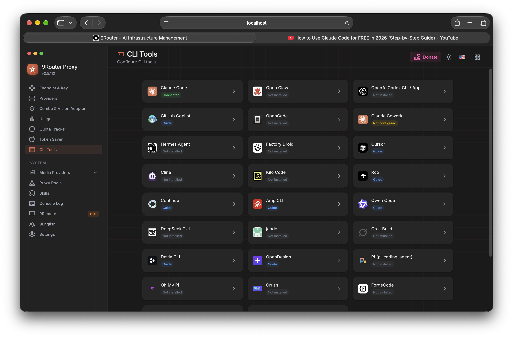
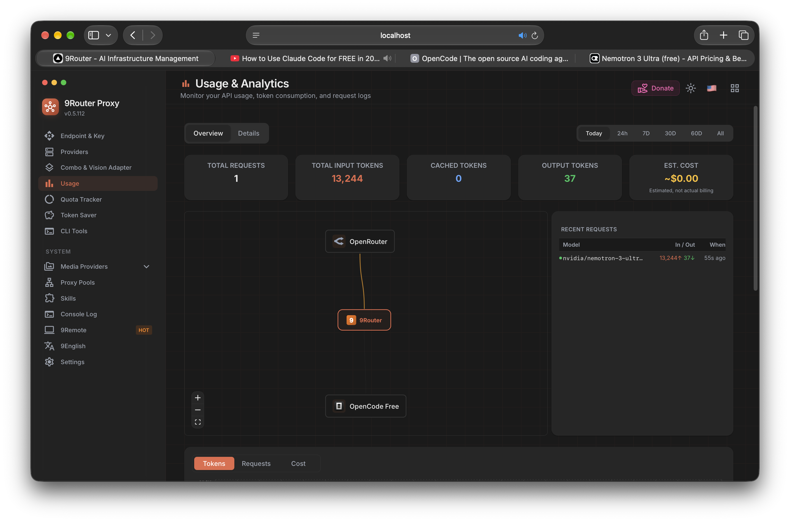

# Day 2: Exploring 9Router

**Can we make AI-assisted coding workflows more flexible without constantly switching providers manually?**

That was the question behind today's experiment.

<!-- truncate -->

While exploring AI developer tools, I came across [9Router](https://9router.com/), a tool designed to connect coding assistants and other AI clients to multiple model providers through a routing layer.

I decided to install it, connect it to OpenRouter, configure a free NVIDIA model, and see how the workflow felt in practice.

## What I wanted to achieve

My goal was simple:

- Install and launch 9Router locally.
- Connect it to OpenRouter.
- Configure `nvidia/nemotron-3-ultra-550b-a55b:free`.
- Check the available providers in the dashboard.
- Test access to the configured provider.
- Explore how provider routing and fallback could help during coding sessions.

## Step 1: Launch 9Router

I launched 9Router locally and chose to open its web interface.

The CLI offered a web interface, an interactive terminal interface, or the option to run 9Router in the background.

Official website: [9router.com](https://9router.com/)

The dashboard is protected by a login screen. The screenshot includes the app's displayed default password, so redact it before publishing this post.

## Step 2: Connect OpenRouter

I added an OpenRouter connection in the 9Router provider settings. The dashboard showed the connection as active and listed models available through OpenRouter.

## Step 3: Choose the NVIDIA Nemotron model

For this experiment, I chose NVIDIA Nemotron 3 Ultra (free):

`nvidia/nemotron-3-ultra-550b-a55b:free`

I checked the model details on OpenRouter and configured 9Router's local endpoint and API key settings for client access.

Using a free model made this a useful experiment for exploring the workflow without starting with a paid model API.

Actual availability, usage limits, and rate limits depend on the provider and model configuration.

The key is masked in the screenshot. Keep provider credentials and API keys private when sharing screenshots.

## Step 4: Connect Claude Code

I then opened Claude Code through the 9Router-backed setup and selected the OpenRouter Nemotron model. This let me try the configured provider from a coding assistant rather than only viewing it in the dashboard.

9Router also provides a CLI tools page for checking integrations with coding tools and assistants.

## Step 5: Check usage

After making a request, I checked the usage dashboard. It showed the request, token counts, estimated cost, and the OpenRouter-to-9Router route.

## Why this caught my attention

If you use AI coding assistants regularly, you may have encountered usage limits, rate limits, or the hassle of switching between models.

9Router is worth exploring because it offers a way to connect coding tools to different providers and supports routing and fallback workflows.

Some things I want to explore further:

- Connecting 9Router to Claude Code.
- Configuring multiple providers in a fallback chain.
- Testing what happens when a provider reaches its usage limit.
- Comparing response quality across different models.
- Understanding the trade-offs between free, low-cost, and subscription-based options.

**Important:** Automatic switching depends on the routing and fallback configuration. Connecting a provider alone does not guarantee that every request will automatically move to another model.

## What I learned

1. I launched 9Router locally.
2. I connected it to OpenRouter.
3. I selected the NVIDIA Nemotron 3 Ultra free model.
4. I connected Claude Code to the configured model and made a request.
5. I checked the resulting usage in 9Router's dashboard.

## What I still want to test

I have not finished exploring everything yet.

My next step is to connect the setup to Claude Code, test an actual coding workflow, and verify provider fallback behavior when a model becomes unavailable or reaches its limit.

That should help me understand how useful this setup is for everyday development.

## Final takeaway

Today's experiment reminded me that building with AI is not only about choosing the best model. It is also about understanding the tools and infrastructure that make AI models easier to use.

9Router looks like a useful tool to investigate if you want more flexibility in your AI development workflow.

I am adding it to my developer toolbox and will continue testing it.

## Resources

- [9Router official website](https://9router.com/)
- [9Router documentation](https://docs.9router.com/)
- [OpenRouter](https://openrouter.ai/)

---

**Day 2 of 365 Days of AI.**

One experiment at a time. Learn, build, document, and share.
